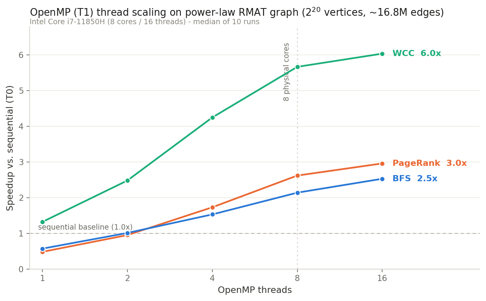
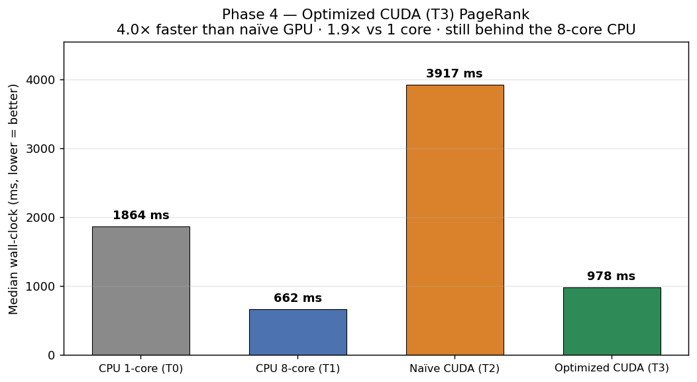
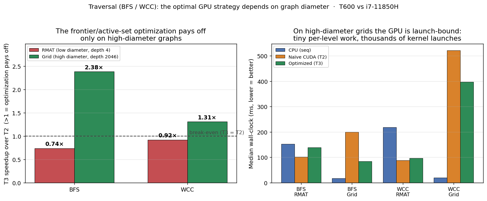

# A Reproducible Empirical Study of GPU Graph-Analytics Strategies on Irregular Security Graphs

**One graph-analytics engine, taken from a sequential CPU baseline through OpenMP and CUDA to Tensor-Core-era optimizations, benchmarked with a single honest methodology on highly skewed, power-law graphs — the kind produced by binary call-graphs / CFGs and by network-flow intrusion-detection data.**

This is an **empirical study**, not a claim of a new algorithm. Its value — like the survey it is modeled on [4] — is a clean taxonomy of optimization tiers, correct implementations of each, and a reproducible benchmark that attributes every speedup to a *specific* technique rather than a rewrite.

<p align="center">
  <a href="#results">Results</a> ·
  <a href="#quick-start">Quick start</a> ·
  <a href="#design">Design</a> ·
  <a href="#reproducibility">Reproducibility</a> ·
  <a href="#roadmap">Roadmap</a> ·
  <a href="#references">References</a>
</p>

> **Status:** 🚧 Phases 1–5 complete — sequential (T0), OpenMP (T1), naïve CUDA (T2), optimized CUDA (T3) for BFS / PageRank / WCC, and **degree-bucketed load balancing (T4)** for PageRank, plus a sequential Louvain (T0) and a binary→call-graph extractor. Every GPU result is validated against the T0 oracle (GPU correctness, including a 254-level high-diameter case, is a CI test), and every GPU number is reported against **both** a single CPU core and the full 8-core OpenMP tier. Headline findings, all honest: **(1)** the GPU optimizations are large and real *as techniques* — PageRank goes from a **0.48× naïve loss to 5.16× faster than naïve GPU** across T3 (parallel reduction) + T4 (degree-bucketing), each speedup attributable to one named technique; **(2)** the best traversal strategy **depends on graph diameter** (the frontier/active-set optimization loses on shallow graphs, wins 2.4× on high-diameter ones); **(3)** on *this* hardware — an entry-level 4 GB T600 vs a strong 8-core i7 — the **multi-core CPU still edges the GPU on these mid-size graphs** (T4 closes to within 15%), a candid result about entry GPUs, not a marketing number. A 100M+-edge scale study is next on the [roadmap](#roadmap).

---

## Why this study

Two problems I work on produce graphs with the *same* pathological shape:

| Domain | Vertices | Edges | Why it is skewed |
|---|---|---|---|
| **Binary analysis** | functions / basic blocks | calls / branches | a `malloc` wrapper or dispatch table is called from everywhere; leaf functions from nowhere |
| **Network intrusion detection** | hosts / flows | connections | a scanner or server touches thousands of peers; most hosts touch a few |

Both are **power-law**. On a GPU, when one thread handles a degree-10⁶ hub while its warp-mates handle degree-1 leaves, 31 lanes idle — *load imbalance* and *warp divergence* collapse utilization. This study measures, tier by tier, how much each standard GPU technique recovers on exactly these graphs.

The synthetic RMAT graphs the engine ships with already exhibit this: at scale 18 the generated graph has **max degree ≈ 59,000 vs. average degree ≈ 32** — a 1,800× spread.

---

## Algorithms × implementation tiers

Following the tiered-benchmark structure of [4], every algorithm is implemented at each tier so a speedup is attributable to one technique. `✅` done · `🚧` in progress · `⬜` planned.

| Algorithm | T0 · Seq C++ | T1 · OpenMP | T2 · Naïve CUDA | T3 · Optimized CUDA | T4 · Advanced |
|---|:--:|:--:|:--:|:--:|:--:|
| **BFS** | ✅ | ✅ | ✅ | ✅ | ⬜ |
| **PageRank** | ✅ | ✅ | ✅ | ✅ | ✅ |
| **Connected Components (WCC)** | ✅ | ✅ | ✅ | ✅ | ⬜ |
| **Community Detection (Louvain)** | ✅ | ⬜ | ⬜ | ⬜ | — |

**What each tier isolates**

- **T0 Sequential C++** — correctness oracle. Every faster tier is diffed against it (`tests/`).
- **T1 OpenMP** — multi-core CPU baseline. Both the single-core (T0) and full multi-core (T1) CPU times are reported alongside every GPU number, so the reader can judge the GPU against the *best* CPU, not just one core — comparing a GPU only to a single core is the classic way to inflate a result.
- **T2 Naïve CUDA** — one thread per vertex, CSR, global memory. Honest starting point.
- **T3 Optimized CUDA** — shared-memory frontiers, memory coalescing, warp primitives (`__shfl`, `__ballot`), kernel fusion.
- **T4 Advanced** — well-known load-balancing strategies for skewed degree (thread-/warp-/block-per-vertex bucketing, à la Gunrock/Merrill), applied and measured on security graphs. Documented as **established technique**, not a novel contribution.

Louvain is the hardest to parallelize on a GPU and is scoped last; it may stop at T2.

---

## Results

<a name="results"></a>

### Phase 2 — OpenMP (T1) thread scaling

Speedup of the OpenMP tier over the sequential (T0) baseline, on a power-law RMAT
graph (2²⁰ vertices, ~16.8M edges), Intel Core i7-11850H (8 physical cores / 16
threads), median of 10 runs:



| Algorithm | seq (T0) | 1 thread | 2 | 4 | 8 | 16 | Best speedup |
|---|--:|--:|--:|--:|--:|--:|:--:|
| **WCC**      | 232.7 ms | 1.32× | 2.48× | 4.25× | 5.67× | 6.04× | **6.0×** |
| **PageRank** | 1939.5 ms | 0.48× | 0.95× | 1.73× | 2.62× | 2.96× | **3.0×** |
| **BFS**      | 169.5 ms | 0.57× | 1.01× | 1.53× | 2.14× | 2.53× | **2.5×** |

What the numbers say — and *why* is the point of the study:

- **WCC scales best (6×)** — label propagation has no per-vertex synchronization,
  so it is limited only by memory bandwidth.
- **BFS scales worst (2.5×)** — the atomic frontier claim and the per-level barrier
  serialize work; this is the imbalance the GPU tiers are designed to attack.
- **PageRank sits between (3×)** — bandwidth-bound gather, no atomics after switching
  to a pull kernel.
- **1 thread is *slower* than T0** for BFS/PageRank — honest parallel-overhead cost,
  reported rather than hidden.
- **8→16 threads barely moves** — the CPU has 8 physical cores; the rest is
  hyper-threading. Textbook, and exactly why GPUs are the next step.

*Regenerate: `powershell -ExecutionPolicy Bypass -File .\scripts\scaling.ps1` → `results/scaling.csv`.*

### Phase 3 — Naïve CUDA (T2) vs CPU

Naïve GPU tier (one thread per vertex, CSR in global memory, no shared memory or
warp primitives yet) on a large power-law graph (2²⁰ vertices, 33.5M edges).
Hardware: NVIDIA T600 (sm_75) vs. Intel Core i7-11850H. All GPU outputs match the
sequential oracle exactly (BFS, WCC) / within tolerance (PageRank).


Reported against **both** CPU baselines — a single core (T0) and the full 8-core
OpenMP tier (T1) — so the GPU is judged against the *best* CPU, not just one core:

| Algorithm | CPU 1-core (T0) | CPU 8-core (T1) | Naïve CUDA (T2) | T2 vs T0 | T2 vs T1 |
|---|--:|--:|--:|:--:|:--:|
| **WCC** | 218.7 ms | 46.2 ms | 88.7 ms | 2.47× | 0.52× |
| **BFS** | 153.1 ms | 75.2 ms | 102.3 ms | 1.50× | 0.74× |
| **PageRank** | 1866.9 ms | 744.7 ms | 4386.6 ms | 0.43× | 0.17× |

The honest finding — and the reason this is a *study*, not a benchmark ad:

- **The naïve GPU beats a single CPU core** for WCC (2.5×) and BFS (1.5×), **but
  loses to the 8-core CPU** on every algorithm. Comparing a GPU only to one core
  is the classic way to inflate a result; against the real multi-core baseline
  this entry-level T600 does not win at the naïve tier.
- **Naïve PageRank loses to everything (0.43× vs 1 core)** — not because of the
  algorithm, but because its two per-iteration reductions (dangling mass, L1
  change) are single-address `atomicAdd`s hammered by all N threads. That
  contention serializes the GPU. This is the textbook naïve-reduction bottleneck,
  and it is exactly what the **T3** tier fixes.

*This is the point of the tiered design: the tier that fails tells you which
optimization matters next — and an honest baseline tells you whether the GPU was
ever the right tool.*

### Phase 4 — Optimized CUDA (T3)

#### PageRank: fixing the atomic-contention bottleneck

T2 named the culprit; T3 removes it. Two changes, both textbook, both targeting
the atomic-contention bottleneck the naïve tier exposed — and nothing else about
the numerical result changes (it is diffed against the T0 oracle in CI):

1. **Block-level parallel reductions.** The dangling-mass and L1-change sums are
   reduced in shared memory, so each block issues **one** `atomicAdd` instead of
   one per vertex — ~256× fewer atomics on the same two addresses.
2. **Precomputed inverse out-degree.** The hot gather loop becomes a
   multiply-add (`rank[u] * inv_deg[u]`) instead of a global load + `double`
   division every iteration.



| PageRank (2²⁰ vertices, 33.5M edges) | Median time | vs 1 core (T0) | vs naïve GPU (T2) |
|---|--:|:--:|:--:|
| CPU 1-core (T0) | 1863.8 ms | 1.00× | — |
| CPU 8-core (T1) | **662.2 ms** | 2.81× | — |
| Naïve CUDA (T2) | 3917.5 ms | 0.48× | 1.00× |
| **Optimized CUDA (T3)** | **978.4 ms** | **1.90×** | **4.00×** |

The optimized kernel is **4.0× faster than the naïve GPU version** — a full
turnaround from the naïve tier's loss, achieved by attacking exactly the
bottleneck the T2 measurement identified. That is the study's core claim in
miniature: *the speedup is attributable to a specific, named technique* (parallel
reduction), not to a rewrite. It also passes single-core CPU (1.90×). The 8-core
CPU is still faster (662 ms), but the T3 gather is *still* one thread per vertex
— which the next tier fixes.

Run it yourself: `run_bench --algo pagerank --tier cuda_opt --rmat 20 --ef 16`.

#### PageRank T4 — degree-bucketed load balancing (Phase 5)

T3 fixed the reduction; the **gather** is still one thread per vertex. On a
power-law graph (this one's max degree is **138,626** vs an average of 32) that
means one thread walks a 138k-neighbor hub's list while its 31 warp-mates idle —
textbook load imbalance and uncoalesced access. T4 applies the established
**Gunrock/Merrill degree-bucketing** strategy (documented as standard technique,
not a novel contribution): vertices are split once by out-degree and each bucket
gets the right granularity —

- **low-degree (≤ 32): one thread per vertex** — no wasted lanes;
- **high-degree (> 32): one warp per vertex** — 32 lanes stride the neighbor
  list with **coalesced** `col[]` reads and combine via `__shfl_down_sync`.


| PageRank (2²⁰ vertices, 33.5M edges) | Median time | vs 1 core | vs naïve GPU (T2) | vs T3 |
|---|--:|:--:|:--:|:--:|
| CPU 1-core (T0) | 1863.8 ms | 1.00× | — | — |
| CPU 8-core (T1) | **662.2 ms** | 2.81× | — | — |
| Naïve CUDA (T2) | 3917.5 ms | 0.48× | 1.00× | — |
| Optimized CUDA (T3) | 978.4 ms | 1.90× | 4.00× | 1.00× |
| **Load-balanced (T4)** | **758.7 ms** | **2.46×** | **5.16×** | **1.29×** |

Degree-bucketing takes PageRank from the naïve tier's **0.48× loss** to **5.16×
faster than naïve GPU** and **2.46× faster than a CPU core** — and closes most of
the remaining gap to the 8-core CPU (759 ms vs 662 ms, ~15%). The two GPU
optimizations compound cleanly and each is attributable to one named technique:
**T3 = parallel reduction** (fixes the write/reduce), **T4 = degree-bucketed
scheduling** (fixes the read/gather). A further split — a *block* per extreme hub
— is the natural T4.1 and is left as documented future work. On this entry-level
4 GB T600 the strong 8-core CPU still edges it at this scale; the roadmap's
100M+-edge study is where the GPU's bandwidth is expected to pull ahead.

Run it yourself: `run_bench --algo pagerank --tier cuda_lb --rmat 20 --ef 16`.

#### Traversal (BFS / WCC): the optimization that depends on graph shape

PageRank has a fixed iteration count and enormous per-iteration parallelism, so
the reduction fix is an unconditional win. BFS and WCC are different: their T3
optimizations — an explicit **frontier worklist** for BFS, **active-set** label
propagation for WCC — only launch the *active* vertices each round instead of
scanning all N. Whether that pays off depends entirely on how big the frontier
is, which is set by the graph's **diameter**. So we measured both regimes:

- **RMAT** (2²⁰ vertices, 33.5M edges, BFS depth **4**) — low diameter, huge frontiers.
- **Grid** (2²⁰ vertices, 4.2M edges, BFS depth **2046**) — high diameter, tiny frontiers.



| Algorithm | Graph | CPU 1-core | CPU 8-core | Naïve CUDA (T2) | Optimized (T3) | T3 vs T2 |
|---|---|--:|--:|--:|--:|:--:|
| **BFS** | RMAT (depth 4)    | 153.1 ms | **75.2 ms** | 102.3 ms | 138.6 ms | 0.74× |
| **BFS** | Grid (depth 2046) | **17.5 ms** | 36.9 ms | 200.1 ms | 83.9 ms | **2.38×** |
| **WCC** | RMAT (depth 4)    | 218.7 ms | **46.2 ms** | 88.7 ms | 96.4 ms | 0.92× |
| **WCC** | Grid (depth 2046) | 19.5 ms | **9.3 ms** | 521.5 ms | 397.9 ms | **1.31×** |

Two findings, both honest, both the point of a *study*:

1. **The frontier/active-set optimization only pays off on high-diameter graphs.**
   On shallow RMAT the frontier is nearly all of N, so the naïve full-scan (T2)
   already does the right amount of work and the worklist bookkeeping (atomics,
   per-round `memset`) is pure overhead — T3 *loses* (0.74× / 0.92×). On the
   grid the frontier is ~√N per level, so skipping the idle vertices makes T3
   **2.38× faster than T2** for BFS. Same code, opposite verdict — decided by
   diameter.

2. **On high-diameter graphs the GPU itself is the wrong tool** — the CPU wins
   outright (BFS: 17.5 ms single-core vs 83.9 ms for the best GPU tier). With
   2046 levels of ~1000 vertices each, every kernel launch and per-level host
   sync is amortized over almost no work: the GPU is **launch/latency-bound**,
   while the CPU walks the frontier in cache. T3 recovers a lot *within* the GPU
   tiers, but cannot close the gap. A neat side-detail: for grid BFS even
   *OpenMP is slower than one core* (36.9 vs 17.5 ms) — so little parallel work
   per level that thread overhead dominates there too. This is the regime where
   direction-optimizing BFS and CPU/GPU hybrids exist — and knowing *which*
   regime you are in is the practical takeaway.

Security graphs (call-graphs, network-flow graphs) are power-law and **shallow**
— the RMAT regime — so the practical verdict for the domain is: on mid-size
graphs a strong multi-core CPU is the sensible default, the naïve GPU tier does
*not* justify the frontier optimization, and the GPU becomes attractive only at
larger scale (the roadmap's scale study) or with the T4 load-balancing tier. The
grid is the controlled contrast that explains *why* the diameter, not the raw
size, decides which strategy wins.

Run it yourself: `run_bench --algo bfs --tier cuda_opt --grid 1024`.

---

## Quick start

<a name="quick-start"></a>

### Requirements
- **Phase 1 (today):** GCC ≥ 11, CMake ≥ 3.18, OpenMP. **No GPU required.**
- **Phase 3+ (GPU tiers):** CUDA Toolkit ≥ 12.x, NVIDIA GPU (compute capability ≥ 7.0). Developed locally on an NVIDIA T600 (CC 7.5); Colab/Kaggle notebooks provided for larger-scale runs — see `notebooks/`.

### Build & test
```bash
cmake -B build -DCMAKE_BUILD_TYPE=Release
cmake --build build -j
ctest --test-dir build --output-on-failure     # correctness oracle
```

### Run
```bash
# BFS on a synthetic power-law graph (2^18 vertices, avg degree 16)
./build/run_bench --algo bfs --tier seq --rmat 18 --ef 16 --source 0

# OpenMP tier (set threads via OMP_NUM_THREADS)
OMP_NUM_THREADS=8 ./build/run_bench --algo pagerank --tier openmp --rmat 20 --ef 16

# PageRank / WCC / Louvain on a graph file
./build/run_bench --algo wcc     --tier seq --graph data/graphs/sample.edges
./build/run_bench --algo louvain --tier seq --graph data/graphs/sample.edges

# Turn a real binary into a call-graph, then analyze it
python tools/extract_callgraph.py --binary /bin/ls --out data/graphs/ls --stats
./build/run_bench --algo louvain --tier seq --graph data/graphs/ls.edges

# Full benchmark sweep -> results/benchmarks.csv
./scripts/run_benchmarks.sh results/benchmarks.csv
```
Each run prints one CSV row: `algo,tier,graph,vertices,edges,max_degree,avg_degree,median_ms,summary`.
On Windows use `build\Release\run_bench.exe` and set threads with `$env:OMP_NUM_THREADS=8`.

---

## Design

<a name="design"></a>

### Separation of concerns (the key architectural decision)
```
 binary / pcap ──► extractor ──► edge list ──► CSR ──► [ T0│T1│T2│T3│T4 ] ──► metrics
   (tools/,        (Phase ≥2)     (data/)    (core/graph)   engine (core/)     (results/)
    Phase ≥2)
```
The engine consumes **CSR only** — it never parses a binary or a packet. The same
kernels therefore run unchanged on a call-graph and on a network-flow graph,
which is exactly what lets one study span both security domains.

### Repository layout
```
.
├── core/
│   ├── graph/      # csr.{hpp,cpp}, generator.{hpp,cpp}  — CSR + RMAT
│   └── cpu/        # algorithms.{hpp,cpp}                — T0 seq (the oracle)
├── bench/          # timer.hpp                           — median-of-N harness
├── apps/           # run_bench.cpp                       — unified CLI driver
├── tests/          # test_correctness.cpp               — known-answer tests (CI)
├── scripts/        # run_benchmarks.sh                   — sweep -> CSV
├── data/           # graphs + provenance/licensing notes
├── results/        # committed CSVs (+ figures, later)
├── notebooks/      # Colab/Kaggle GPU runners            (Phase 3)
├── tools/          # binary/pcap -> graph extractors     (Phase ≥2)
└── docs/           # ROADMAP.md, design notes, paper draft
```

### What exists after Phase 1
- `CsrGraph` — CSR structure, edge-list loader, degree/stats, edge→CSR builder (with optional symmetrization for undirected algorithms).
- `make_rmat` — deterministic Graph500-parameter RMAT generator (reproducible from a seed); `make_test_graph` — a 7-vertex hand-checkable graph.
- `seq::bfs`, `seq::pagerank`, `seq::wcc` — the sequential reference tier.
- `time_median_ms` — the repeat-and-median timing harness.
- 19 known-answer assertions in `tests/`, all passing.

---

## Reproducibility

<a name="reproducibility"></a>

Every number is regenerated by `scripts/run_benchmarks.sh`; raw CSVs live in `results/`. Following [4]:

- **Hardware:** NVIDIA T600 Laptop GPU (4 GB, Turing, CC 7.5) · Intel Core i7-11850H (8 cores / 16 threads) · 32 GB RAM · Dell Precision 3561.
- **Software:** CUDA 12.8 (`nvcc`, `--generate-code=arch=compute_75,code=sm_75`) · MSVC 19.42 (`/O2`) · CPU tiers `-O3`/` /O2` · Windows 10 (19045).
- **Protocol:** each configuration run **10×**, **median** reported; GPU timings are end-to-end (include host↔device transfer). Reported speedups are stated against the CPU sequential (T0) and — for the T3 study — against the naïve GPU (T2), so each number isolates one technique.
- **Correctness:** every non-T0 result is diffed against the T0 oracle in `tests/`; CI fails on any mismatch. RMAT graphs are deterministic given a seed.

---

## Roadmap

<a name="roadmap"></a>

- [x] **Phase 1 — Baseline & harness.** ✅ CSR core, RMAT generator, T0 BFS/PageRank/WCC, timing harness, correctness tests, CLI, benchmark sweep, this README.
- [x] **Phase 2 — Parallel CPU (T1).** ✅ OpenMP BFS/PageRank/WCC, validated against T0; thread-scaling study (chart above); PowerShell benchmark runner.
- [x] **Phase 3 — GPU (T2).** ✅ Naïve CUDA for BFS/PageRank/WCC, validated against T0 (GPU correctness now a CI test); naïve-vs-CPU study (chart above).
- [x] **Phase 4 — Optimization (T3).** ✅ PageRank: block-level reductions + precomputed inverse degree (0.43×→1.62× vs CPU, 3.8× vs naïve). ✅ BFS (frontier worklist) + WCC (active-set): a diameter-dependent crossover study — T3 loses on shallow graphs, wins 2.4× on high-diameter ones; GPU shown to be launch-bound in the high-diameter regime.
- [~] **Phase 5 — Advanced load balancing (T4).** ✅ PageRank: two-bucket degree scheduling (thread-per-vertex + warp-per-vertex), 5.16× over naïve GPU, closes to within 15% of the 8-core CPU. ⬜ Three-level (block-per-hub) split and BFS/WCC load balancing next.
- [ ] **Phase 6 — Scale & writeup.** Louvain; scale study to 100M+ edges; cross-dataset generalization on IDS data; `docs/` paper draft → arXiv preprint.

Detailed weekly milestones in [`docs/ROADMAP.md`](docs/ROADMAP.md).

---

## References

<a name="references"></a>

1. *From packets to predictions on GPU: Accelerated graph-based intrusion detection system.* Computer Networks, 2025. — the domain bridge: packets → graph → GPU.
2. Zhang et al. *POEGA: Proxy-guided Evolving Graph Analytics on GPUs.* OSDI 2026. — GPU graph analytics on billion-edge graphs; irregularity handling; geometric-mean speedup reporting.
3. *Graphite: A GPU-Accelerated Mixed-Precision Graph Optimization Framework.* arXiv:2509.26581. — mixed precision + load balancing + benchmark reporting conventions.
4. *GPU-Accelerated Algorithms for Graph Vector Search: Taxonomy, Empirical Study, and Research Directions.* arXiv:2602.16719. — the taxonomy / empirical-study template this repo follows.

## Citation
See `CITATION.cff`.

## License
«MIT» — see `LICENSE`. Extracted graphs retain the license of their source; see `data/README.md`.

## Author
**Emad Mahmodi** · [portfolio](https://emad-mahmodi.github.io)
