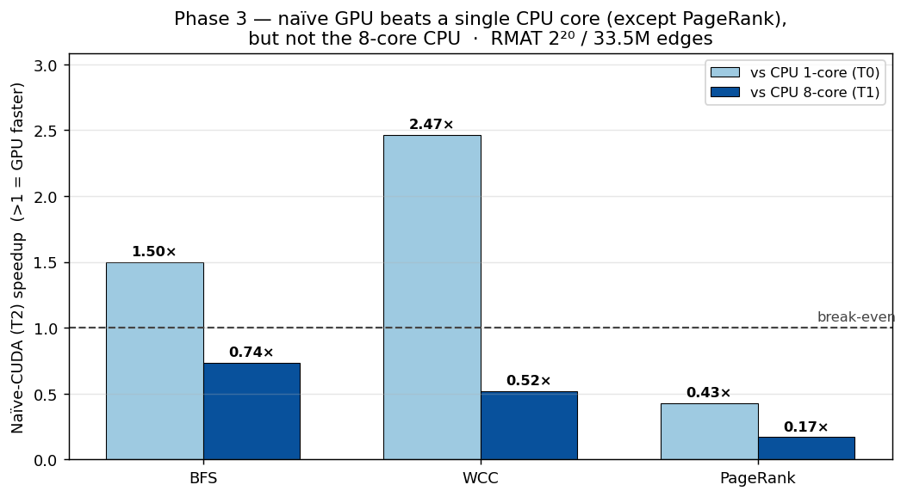
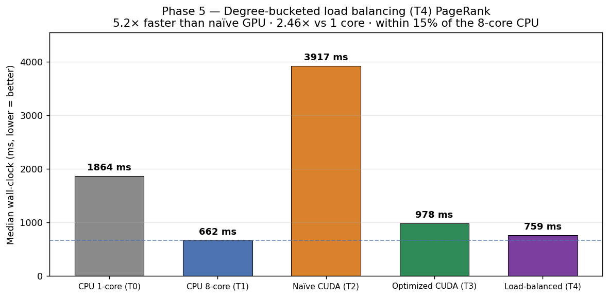
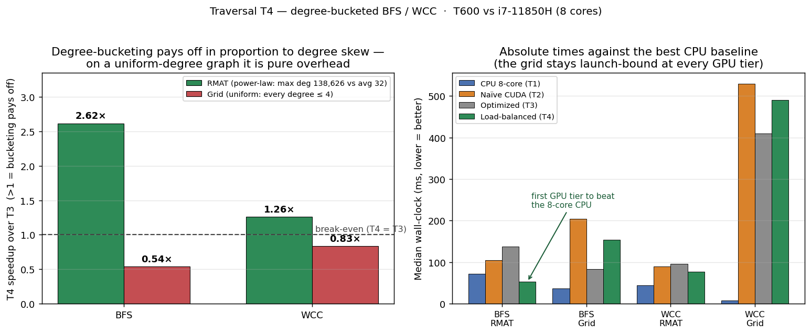
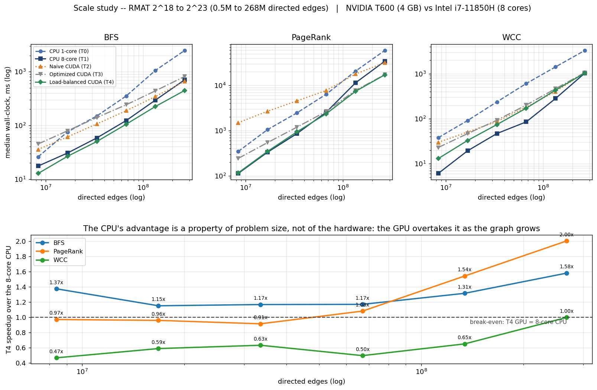

# A Reproducible Empirical Study of GPU Graph-Analytics Strategies on Irregular Security Graphs

**One graph-analytics engine, taken from a sequential CPU baseline through OpenMP and CUDA to Tensor-Core-era optimizations, benchmarked with a single honest methodology on highly skewed, power-law graphs — the kind produced by binary call-graphs / CFGs and by network-flow intrusion-detection data.**

This is an **empirical study**, not a claim of a new algorithm. Its value — like the survey it is modeled on [4] — is a clean taxonomy of optimization tiers, correct implementations of each, and a reproducible benchmark that attributes every speedup to a *specific* technique rather than a rewrite.

<p align="center">
  <a href="#results">Results</a> ·
  <a href="#quick-start">Quick start</a> ·
  <a href="#design">Design</a> ·
  <a href="#reproducibility">Reproducibility</a> ·
  <a href="#roadmap">Roadmap</a> ·
  <a href="#references">References</a>
</p>

> **Status:** ✅ Phases 1–5 complete — sequential (T0), OpenMP (T1), naïve CUDA (T2), optimized CUDA (T3) and **degree-bucketed load balancing (T4)** for BFS / PageRank / WCC, plus a sequential Louvain (T0) and a binary→call-graph extractor. Every GPU result is validated against the T0 oracle (GPU correctness, including a 254-level high-diameter case, is a CI test), and every GPU number is reported against **both** a single CPU core and the full 8-core OpenMP tier. Headline findings, all honest: **(1)** the optimizations are large and real *as techniques*, each attributable to one named change — PageRank goes from a **0.48× naïve loss to 5.16× faster than naïve GPU** (T3 parallel reduction + T4 degree-bucketing), and **BFS from a 0.76× T3 loss to 2.62× faster than T3** by bucketing alone; **(2)** which optimization wins is decided by *graph shape*, on two independent axes — the frontier/active-set optimization (T3) pays off in proportion to **diameter**, degree-bucketing (T4) in proportion to **degree skew**, and each is a measured *loss* in the other regime; **(3)** the CPU-versus-GPU verdict is a property of **problem size**, not of the hardware — a scale study from 8.4M to **268M directed edges** shows PageRank going from a 0.91× loss at the size this repo used to report to **2.00× the 8-core CPU** at 268M, with no code change at all, while naïve CUDA (T2) never justifies itself at any size tested. A GPU-vs-CPU number quoted without the graph size is not a result.

---

## Why this study

Two problems I work on produce graphs with the *same* pathological shape:

| Domain | Vertices | Edges | Why it is skewed |
|---|---|---|---|
| **Binary analysis** | functions / basic blocks | calls / branches | a `malloc` wrapper or dispatch table is called from everywhere; leaf functions from nowhere |
| **Network intrusion detection** | hosts / flows | connections | a scanner or server touches thousands of peers; most hosts touch a few |

Both are **power-law**. On a GPU, when one thread handles a degree-10⁶ hub while its warp-mates handle degree-1 leaves, 31 lanes idle — *load imbalance* and *warp divergence* collapse utilization. This study measures, tier by tier, how much each standard GPU technique recovers on exactly these graphs.

The synthetic RMAT graphs the engine ships with already exhibit this: at scale 18 the generated graph has **max degree ≈ 59,000 vs. average degree ≈ 32** — a 1,800× spread.

---

## Algorithms × implementation tiers

Following the tiered-benchmark structure of [4], every algorithm is implemented at each tier so a speedup is attributable to one technique. `✅` done · `🚧` in progress · `⬜` planned.

| Algorithm | T0 · Seq C++ | T1 · OpenMP | T2 · Naïve CUDA | T3 · Optimized CUDA | T4 · Advanced |
|---|:--:|:--:|:--:|:--:|:--:|
| **BFS** | ✅ | ✅ | ✅ | ✅ | ✅ |
| **PageRank** | ✅ | ✅ | ✅ | ✅ | ✅ |
| **Connected Components (WCC)** | ✅ | ✅ | ✅ | ✅ | ✅ |
| **Community Detection (Louvain)** | ✅ | ✅ᵇ | ✅ᵇ | ⬜ | ⬜ᶜ |

**What each tier isolates**

- **T0 Sequential C++** — correctness oracle. Every faster tier is diffed against it (`tests/`).
- **T1 OpenMP** — multi-core CPU baseline. Both the single-core (T0) and full multi-core (T1) CPU times are reported alongside every GPU number, so the reader can judge the GPU against the *best* CPU, not just one core — comparing a GPU only to a single core is the classic way to inflate a result.
- **T2 Naïve CUDA** — one thread per vertex, CSR, global memory. Honest starting point.
- **T3 Optimized CUDA** — shared-memory frontiers, memory coalescing, warp primitives (`__shfl`, `__ballot`), kernel fusion.
- **T4 Advanced** — well-known load-balancing strategies for skewed degree (thread-/warp-/block-per-vertex bucketing, à la Gunrock/Merrill), applied and measured on security graphs. Documented as **established technique**, not a novel contribution.

ᵇ Louvain is the one algorithm whose parallel tiers cannot return the oracle's answer: sequential Louvain is order-dependent by construction, so T1 and T2 are contracted on *quality* rather than on equality, and neither is ever quoted without its modularity column. See [Louvain](#phase-6--louvain-at-t1-the-algorithm-that-resists-parallelism).

ᶜ This cell used to read “—”, on the assumption that degree-bucketed load balancing had nothing to say about community detection. That was wrong, and implementing T2 is what showed it: Louvain needs, per vertex, the summed weight to each *distinct neighbouring community*, and the size of that accumulator is set by the vertex's degree. For BFS, PageRank and WCC, bucketing by degree was an optimization; for Louvain it is the precondition for using shared memory at all. T4 is therefore planned, not inapplicable.

---

## Results

<a name="results"></a>

### Phase 2 — OpenMP (T1) thread scaling

Speedup of the OpenMP tier over the sequential (T0) baseline, on a power-law RMAT
graph (2²⁰ vertices, ~16.8M edges), Intel Core i7-11850H (8 physical cores / 16
threads), median of 10 runs:


| Algorithm | seq (T0) | 1 thread | 2 | 4 | 8 | 16 | Best speedup |
|---|--:|--:|--:|--:|--:|--:|:--:|
| **WCC**      | 232.7 ms | 1.32× | 2.48× | 4.25× | 5.67× | 6.04× | **6.0×** |
| **PageRank** | 1939.5 ms | 0.48× | 0.95× | 1.73× | 2.62× | 2.96× | **3.0×** |
| **BFS**      | 169.5 ms | 0.57× | 1.01× | 1.53× | 2.14× | 2.53× | **2.5×** |

What the numbers say — and *why* is the point of the study:

- **WCC scales best (6×)** — label propagation has no per-vertex synchronization,
  so it is limited only by memory bandwidth.
- **BFS scales worst (2.5×)** — the atomic frontier claim and the per-level barrier
  serialize work; this is the imbalance the GPU tiers are designed to attack.
- **PageRank sits between (3×)** — bandwidth-bound gather, no atomics after switching
  to a pull kernel.
- **1 thread is *slower* than T0** for BFS/PageRank — honest parallel-overhead cost,
  reported rather than hidden.
- **8→16 threads barely moves** — the CPU has 8 physical cores; the rest is
  hyper-threading. Textbook, and exactly why GPUs are the next step.

*Regenerate: `powershell -ExecutionPolicy Bypass -File .\scripts\scaling.ps1` → `results/scaling.csv`.*

### Phase 3 — Naïve CUDA (T2) vs CPU

Naïve GPU tier (one thread per vertex, CSR in global memory, no shared memory or
warp primitives yet) on a large power-law graph (2²⁰ vertices, 33.5M edges).
Hardware: NVIDIA T600 (sm_75) vs. Intel Core i7-11850H. All GPU outputs match the
sequential oracle exactly (BFS, WCC) / within tolerance (PageRank).



Reported against **both** CPU baselines — a single core (T0) and the full 8-core
OpenMP tier (T1) — so the GPU is judged against the *best* CPU, not just one core:

| Algorithm | CPU 1-core (T0) | CPU 8-core (T1) | Naïve CUDA (T2) | T2 vs T0 | T2 vs T1 |
|---|--:|--:|--:|:--:|:--:|
| **WCC** | 218.7 ms | 46.2 ms | 88.7 ms | 2.47× | 0.52× |
| **BFS** | 153.1 ms | 75.2 ms | 102.3 ms | 1.50× | 0.74× |
| **PageRank** | 1866.9 ms | 744.7 ms | 4386.6 ms | 0.43× | 0.17× |

The honest finding — and the reason this is a *study*, not a benchmark ad:

- **The naïve GPU beats a single CPU core** for WCC (2.5×) and BFS (1.5×), **but
  loses to the 8-core CPU** on every algorithm. Comparing a GPU only to one core
  is the classic way to inflate a result; against the real multi-core baseline
  this entry-level T600 does not win at the naïve tier.
- **Naïve PageRank loses to everything (0.43× vs 1 core)** — not because of the
  algorithm, but because its two per-iteration reductions (dangling mass, L1
  change) are single-address `atomicAdd`s hammered by all N threads. That
  contention serializes the GPU. This is the textbook naïve-reduction bottleneck,
  and it is exactly what the **T3** tier fixes.

*This is the point of the tiered design: the tier that fails tells you which
optimization matters next — and an honest baseline tells you whether the GPU was
ever the right tool.*

### Phase 4 — Optimized CUDA (T3)

#### PageRank: fixing the atomic-contention bottleneck

T2 named the culprit; T3 removes it. Two changes, both textbook, both targeting
the atomic-contention bottleneck the naïve tier exposed — and nothing else about
the numerical result changes (it is diffed against the T0 oracle in CI):

1. **Block-level parallel reductions.** The dangling-mass and L1-change sums are
   reduced in shared memory, so each block issues **one** `atomicAdd` instead of
   one per vertex — ~256× fewer atomics on the same two addresses.
2. **Precomputed inverse out-degree.** The hot gather loop becomes a
   multiply-add (`rank[u] * inv_deg[u]`) instead of a global load + `double`
   division every iteration.


| PageRank (2²⁰ vertices, 33.5M edges) | Median time | vs 1 core (T0) | vs naïve GPU (T2) |
|---|--:|:--:|:--:|
| CPU 1-core (T0) | 1863.8 ms | 1.00× | — |
| CPU 8-core (T1) | **662.2 ms** | 2.81× | — |
| Naïve CUDA (T2) | 3917.5 ms | 0.48× | 1.00× |
| **Optimized CUDA (T3)** | **978.4 ms** | **1.90×** | **4.00×** |

The optimized kernel is **4.0× faster than the naïve GPU version** — a full
turnaround from the naïve tier's loss, achieved by attacking exactly the
bottleneck the T2 measurement identified. That is the study's core claim in
miniature: *the speedup is attributable to a specific, named technique* (parallel
reduction), not to a rewrite. It also passes single-core CPU (1.90×). The 8-core
CPU is still faster (662 ms), but the T3 gather is *still* one thread per vertex
— which the next tier fixes.

Run it yourself: `run_bench --algo pagerank --tier cuda_opt --rmat 20 --ef 16`.

#### PageRank T4 — degree-bucketed load balancing (Phase 5)

T3 fixed the reduction; the **gather** is still one thread per vertex. On a
power-law graph (this one's max degree is **138,626** vs an average of 32) that
means one thread walks a 138k-neighbor hub's list while its 31 warp-mates idle —
textbook load imbalance and uncoalesced access. T4 applies the established
**Gunrock/Merrill degree-bucketing** strategy (documented as standard technique,
not a novel contribution): vertices are split once by out-degree and each bucket
gets the right granularity —

- **low-degree (≤ 32): one thread per vertex** — no wasted lanes;
- **mid-degree (33–1024): one warp per vertex** — 32 lanes stride the neighbor
  list with **coalesced** `col[]` reads and combine via `__shfl_down_sync`;
- **high-degree (> 1024): one block per vertex** — 256 threads cooperate on a
  single extreme hub, with a shared-memory tree reduction.

This is the full three-level thread → warp → block hierarchy of the standard
Gunrock scheduler.



| PageRank (2²⁰ vertices, 33.5M edges) | Median time | vs 1 core | vs naïve GPU (T2) | vs T3 |
|---|--:|:--:|:--:|:--:|
| CPU 1-core (T0) | 1863.8 ms | 1.00× | — | — |
| CPU 8-core (T1) | **662.2 ms** | 2.81× | — | — |
| Naïve CUDA (T2) | 3917.5 ms | 0.48× | 1.00× | — |
| Optimized CUDA (T3) | 978.4 ms | 1.90× | 4.00× | 1.00× |
| **Load-balanced (T4)** | **758.7 ms** | **2.46×** | **5.16×** | **1.29×** |

Degree-bucketing takes PageRank from the naïve tier's **0.48× loss** to **5.16×
faster than naïve GPU** and **2.46× faster than a CPU core** — and closes most of
the remaining gap to the 8-core CPU (759 ms vs 662 ms, ~15%). The two GPU
optimizations compound cleanly and each is attributable to one named technique:
**T3 = parallel reduction** (fixes the write/reduce), **T4 = degree-bucketed
scheduling** (fixes the read/gather).

**A measured point of diminishing returns:** the third level — a *block* per
extreme hub — was implemented and benchmarked, and gives **no gain over
warp-per-vertex alone** on this graph (764.9 ms with the block level vs 758.7 ms
without — inside run-to-run noise). The reason is structural: RMAT's power-law
tail has few vertices above degree 1024, so the extra block-level parallelism
applies to a small share of the total edge work while the two-level scheme
already saturated the benefit. It is kept in the code (the full Gunrock
hierarchy) but honestly reported as *not* helping here — the kind of result a
tiered study exists to surface. On this entry-level 4 GB T600 the strong 8-core
CPU still edges the GPU at this scale; the roadmap's 100M+-edge study is where
the GPU's bandwidth is expected to pull ahead.

Run it yourself: `run_bench --algo pagerank --tier cuda_lb --rmat 20 --ef 16`.

#### Traversal (BFS / WCC): the optimization that depends on graph shape

PageRank has a fixed iteration count and enormous per-iteration parallelism, so
the reduction fix is an unconditional win. BFS and WCC are different: their T3
optimizations — an explicit **frontier worklist** for BFS, **active-set** label
propagation for WCC — only launch the *active* vertices each round instead of
scanning all N. Whether that pays off depends entirely on how big the frontier
is, which is set by the graph's **diameter**. So we measured both regimes:

- **RMAT** (2²⁰ vertices, 33.5M edges, BFS depth **4**) — low diameter, huge frontiers.
- **Grid** (2²⁰ vertices, 4.2M edges, BFS depth **2046**) — high diameter, tiny frontiers.


| Algorithm | Graph | CPU 1-core | CPU 8-core | Naïve CUDA (T2) | Optimized (T3) | T3 vs T2 |
|---|---|--:|--:|--:|--:|:--:|
| **BFS** | RMAT (depth 4)    | 149.7 ms | **72.4 ms** | 104.1 ms | 137.8 ms | 0.76× |
| **BFS** | Grid (depth 2046) | **17.3 ms** | 36.0 ms | 204.3 ms | 82.8 ms | **2.47×** |
| **WCC** | RMAT (depth 4)    | 207.7 ms | **44.5 ms** | 89.0 ms | 96.2 ms | 0.93× |
| **WCC** | Grid (depth 2046) | 20.1 ms | **7.3 ms** | 529.5 ms | 409.2 ms | **1.29×** |

*These traversal rows and the T4 table below come from one sweep
(`scripts/traversal_lb.ps1` → `results/traversal_lb.csv`), because attributing
T4 requires T0–T4 measured back to back. They therefore differ by ~2% from the
Phase 3 table above, which is its own internally consistent session — no table
here mixes runs.*

Two findings, both honest, both the point of a *study*:

1. **The frontier/active-set optimization only pays off on high-diameter graphs.**
   On shallow RMAT the frontier is nearly all of N, so the naïve full-scan (T2)
   already does the right amount of work and the worklist bookkeeping (atomics,
   per-round `memset`) is pure overhead — T3 *loses* (0.76× / 0.93×). On the
   grid the frontier is ~√N per level, so skipping the idle vertices makes T3
   **2.47× faster than T2** for BFS. Same code, opposite verdict — decided by
   diameter.

2. **On high-diameter graphs the GPU itself is the wrong tool** — the CPU wins
   outright (BFS: 17.3 ms single-core vs 82.8 ms for the best GPU tier). With
   2046 levels of ~1000 vertices each, every kernel launch and per-level host
   sync is amortized over almost no work: the GPU is **launch/latency-bound**,
   while the CPU walks the frontier in cache. T3 recovers a lot *within* the GPU
   tiers, but cannot close the gap. A neat side-detail: for grid BFS even
   *OpenMP is slower than one core* (36.0 vs 17.3 ms) — so little parallel work
   per level that thread overhead dominates there too. This is the regime where
   direction-optimizing BFS and CPU/GPU hybrids exist — and knowing *which*
   regime you are in is the practical takeaway.

Security graphs (call-graphs, network-flow graphs) are power-law and **shallow**
— the RMAT regime — so the verdict *at this tier* is: the frontier optimization
is not what these graphs need, and a strong multi-core CPU is still the sensible
default. The grid is the controlled contrast that explains *why* the diameter,
not the raw size, decides which strategy wins. What the T3 measurement does not
tell you is what these graphs need *instead* — and the next tier answers that:
degree-bucketing, on the same shallow RMAT graph where T3 lost, is the one thing
in this study that beats the 8-core CPU.

Run it yourself: `run_bench --algo bfs --tier cuda_opt --grid 1024`.

#### Traversal T4 — degree-bucketed BFS / WCC (Phase 5)

T3 fixed *which* vertices run each round. It did not fix *how* one runs: a
thread owning this graph's 138,626-neighbour hub still walked that list alone
while its 31 warp-mates held degree-1 leaves. T4 applies the same three-level
Gunrock/Merrill bucketing that PageRank uses — with one structural difference
that turns out to matter:

- **PageRank and WCC bucket once, on the host.** Every vertex is a candidate
  every round and degrees never change, so a single static split is enough.
- **BFS must re-bucket every level, on the device.** The frontier is a
  *different* set of vertices at each level, so a split kernel re-partitions it
  each round — the roadmap's "re-bucket between BFS levels". The price is a
  second device→host sync per level, to size the three expand grids.

Crucially, T4 does not do *less* work than T3: it visits exactly the same edges
and claims vertices with the same `atomicCAS`. Only the mapping of threads to
edges changes, which is what makes the speedup attributable to one named
technique.



| Algorithm | Graph | CPU 1-core | CPU 8-core | Naïve (T2) | Optimized (T3) | **Bucketed (T4)** | T4 vs T3 | T4 vs T2 |
|---|---|--:|--:|--:|--:|--:|:--:|:--:|
| **BFS** | RMAT — max degree 138,626 | 149.7 ms | 72.4 ms | 104.1 ms | 137.8 ms | **52.6 ms** | **2.62×** | **1.98×** |
| **BFS** | Grid — every degree ≤ 4    | **17.3 ms** | 36.0 ms | 204.3 ms | 82.8 ms | 154.1 ms | 0.54× | 1.33× |
| **WCC** | RMAT — max degree 138,626 | 207.7 ms | **44.5 ms** | 89.0 ms | 96.2 ms | 76.3 ms | **1.26×** | 1.17× |
| **WCC** | Grid — every degree ≤ 4    | 20.1 ms | **7.3 ms** | 529.5 ms | 409.2 ms | 490.6 ms | 0.83× | 1.08× |

Three findings:

1. **BFS on a power-law graph is where this repo's argument finally lands.**
   T4 is **2.62× faster than T3**, **1.98× faster than the naïve GPU**, and —
   for the first time anywhere in this study — **faster than the full 8-core
   CPU** (52.6 ms vs 72.4 ms, **1.38×**). The attribution is unusually clean
   because T3 was a *loss* on this graph (0.76× vs T2): the frontier worklist
   alone made BFS slower, and it is the degree-bucketing alone that turns it
   into the study's best GPU result. Load imbalance, not the frontier, was the
   binding constraint all along.

2. **On the uniform-degree grid, bucketing is pure overhead** — 0.54× for BFS
   and 0.83× for WCC against T3. Every grid vertex has degree ≤ 4, so all of
   them land in the low bucket: the split kernel, the three launches and the
   extra per-level sync buy nothing and cost a lot. BFS suffers worst because
   its 2046 levels pay that overhead 2046 times over. Same code, opposite
   verdict — and this time the deciding property is degree **skew**, not
   diameter.

3. **WCC improves but does not catch the CPU** (76.3 ms vs 44.5 ms). Bucketing
   gives a real 1.26×, but label propagation does little work per round over
   many rounds, so the GPU never amortizes its launch and sync cost the way
   PageRank's 100 dense iterations do.

Taken together the two traversal studies isolate two *independent* graph
properties: **T3's payoff is set by diameter** (how big the frontier is) and
**T4's by degree skew** (how imbalanced the per-vertex work is). Security
graphs — call-graphs, network-flow graphs — are shallow *and* skewed, i.e.
precisely the regime where T3 loses and T4 wins, which is what the RMAT rows
above measure. That is a concrete, testable recommendation for the domain
rather than a generic "use a GPU".

Run it yourself: `run_bench --algo bfs --tier cuda_lb --rmat 20 --ef 16`.
*Regenerate the whole table: `powershell -ExecutionPolicy Bypass -File .\scripts\traversal_lb.ps1`.*

### Phase 6 — Scale study: 0.5M to 268M edges

Every result above was measured at one size (2²⁰ vertices, 33.5M edges), and at
that size a strong 8-core i7 beat this entry-level T600 nearly everywhere. That
left the study's most important question unanswered: was that a fact about the
**hardware**, or about the **problem size**? A GPU pays fixed costs —
host↔device transfer, kernel launches, a host sync per round — and a small
graph gives it too little work to amortize them.

So the whole tier stack was re-run across RMAT 2¹⁸ → 2²³, i.e. **8.4M to 268M
directed edges** (8.4M vertices, max degree 486,556 at the top end), every tier
at every size in one session.



**T4 GPU vs the full 8-core CPU, as the graph grows:**

| Directed edges | 8.4M | 16.8M | 33.5M | 67.1M | 134M | 268M |
|---|:--:|:--:|:--:|:--:|:--:|:--:|
| **BFS**      | 1.37× | 1.15× | 1.17× | 1.17× | **1.31×** | **1.58×** |
| **PageRank** | 0.97× | 0.96× | 0.91× | **1.08×** | **1.54×** | **2.00×** |
| **WCC**      | 0.47× | 0.59× | 0.63× | 0.50× | 0.65× | **1.00×** |

The answer is unambiguous: **it was the problem size.**

- **PageRank crosses over at 67M edges** and reaches **2.00× the 8-core CPU** at
  268M — having been a 0.91× *loss* at the 33.5M size this repo used to report.
  Nothing about the code changed between those two numbers; only the graph grew.
- **BFS is above the CPU across the whole range** and pulls away with size
  (1.17× → 1.58×).
- **WCC climbs steadily and reaches exactly break-even (1.00×) at 268M edges** —
  the honest reading is that its crossover is just past the largest graph this
  4 GB card can hold, not that it does not exist.

The log-log panels show why. Every tier scales close to linearly in edges, so
the *ordering* is decided by the constant factor each tier carries, and the GPU
constants (transfer, launch, sync) are the ones that shrink relative to the work
as the graph grows. This is also the cleanest statement of the study's thesis:
a GPU-versus-CPU verdict quoted without the problem size is not a result.

Two corollaries worth stating plainly, because they cut against the usual
marketing:

1. **Naive CUDA (T2) never justifies itself.** It only reaches the 8-core CPU at
   268M edges (BFS 1.07×, PageRank 1.08×) — the size at which the *optimized*
   tiers are already at 1.6–2.0×. Writing the obvious GPU port and stopping
   there gets you a slower program than your CPU on every graph tested here.
2. **The entry-level card is not the bottleneck people assume.** A 4 GB T600 is
   about as modest as a discrete CUDA GPU gets, and it still doubles a strong
   8-core CPU on PageRank once the graph is large enough to keep it busy.

*Regenerate: `powershell -ExecutionPolicy Bypass -File .\scripts\scale_study.ps1` (~40 min) → `results/scale_study.csv`, then `python scripts/make_scale_chart.py`.*

### Phase 6 — Louvain at T1: the algorithm that resists parallelism

The other three algorithms have a parallel tier that returns *the same answer*
as the T0 oracle. Louvain cannot, and saying otherwise would be dishonest.
Sequential Louvain is Gauss-Seidel: it moves one vertex at a time and every move
is immediately visible to the next vertex, so the result is a function of the
visiting order. Any parallel formulation gives that up.

This tier is Jacobi with a chunked barrier — vertices decide from a shared
snapshot, but a pass is split into a few sequential chunks so each chunk sees
the previous one's moves (Lu, Halappanavar & Kalyanaraman, *Parallel Computing*
2015). Two safeguards: the **min-label rule**, which stops two singleton
vertices from swapping communities forever, and a **modularity guard** that
measures Q after each pass and rolls the pass back if it did not improve — so
this tier is monotone in Q like the oracle, at the cost of one extra O(m) sweep
per pass.

The chunk count is the single design parameter, and it is a direct quality/speed
dial. Measured on RMAT 2¹⁷, 8 threads, against the oracle's 1840 ms / Q = 0.0792:

| chunks per pass | time | Q | quality vs T0 | speedup |
|---|--:|--:|:--:|:--:|
| 1 (pure Jacobi) | 240 ms | 0.0575 | 72.6% | 7.67× |
| **4** (shipped) | **507 ms** | **0.0741** | **93.6%** | **3.63×** |
| 16 | 900 ms | 0.0745 | 94.1% | 2.05× |
| 64 | 1868 ms | 0.0762 | 96.2% | 0.99× |
| 256 | 2860 ms | 0.0765 | 96.6% | 0.64× |

The knee is unambiguous: 1 → 4 chunks buys 21 points of community quality for a
2.1× slowdown, while 4 → 16 buys half a point for another 1.8×. By 64 chunks
the "parallel" tier has given up its entire advantage (0.99×), and beyond that
it is **slower than the single-core oracle it is meant to accelerate**. Shipping
pure Jacobi because it posts a 7.7× number would mean quietly returning
communities a quarter worse than the reference — exactly the kind of speedup
this study exists to refuse.

The Q column is identical across repeated runs of this table: the tier is
deterministic, so only the timings move with thermal conditions.

At the shipped setting, across sizes:

| RMAT scale | T0 oracle | T1 · 8 threads | speedup | quality |
|---|--:|--:|:--:|:--:|
| 2¹⁴ | 241 ms | 66 ms | 3.64× | 92.4% |
| 2¹⁶ | 796 ms | 200 ms | 3.98× | 93.4% |
| 2¹⁷ | 1758 ms | 433 ms | 4.06× | 93.6% |
| 2¹⁸ | 4910 ms | 761 ms | **6.45×** | 93.9% |

So the honest summary for Louvain at T1 is: **~6% of the modularity buys 3.6–6.5×**,
and that trade is stated rather than hidden. One property the parallel tier has
that the oracle does not: because every vertex decides from a snapshot rather
than from whatever its neighbours did first, the result does **not depend on the
thread count** — 1 thread and 16 threads produce identical communities, which is
a CI assertion, not a claim.

Run it yourself: `run_bench --algo louvain --tier openmp --rmat 17 --ef 16`.
*Regenerate: `.\scripts\louvain_chunks.ps1` → `results/louvain_chunks.csv` (the ablation) and
`.\scripts\louvain_scale.ps1` → `results/louvain_scale.csv` (the size table).*

#### Louvain T2 — and the number that confirmed the diagnosis

The GPU tier needs something the other three algorithms never do: for each
vertex, the summed weight to *each distinct neighbouring community*. On the CPU
that is a dense array of size n per thread. With tens of thousands of GPU
threads in flight it cannot be, and that single requirement is the whole
difficulty of putting Louvain on a GPU.

The obvious GPU answer is a per-warp hash table in shared memory. T2 does not
use one, on purpose: a hub with half a million neighbours can touch more
distinct communities than any shared table holds, so a hash table needs an
overflow path — which is most of the degree-bucketed machinery T4 exists to
isolate. Building it here would make the later speedup unattributable. So T2
does the plainly correct thing instead: label every arc with
`(owner vertex, neighbour community)`, sort, and reduce equal keys. No capacity
limit, no special case, no tuning — and predictably slow, which is what an
honest baseline is for. The same primitive builds the next level's graph, with
the key changed to `(community of u, community of v)`.

| RMAT scale | T0 oracle | T1 · 8 threads | T2 · CUDA | T2 vs one core | T1 quality | **T2 quality** |
|---|--:|--:|--:|:--:|:--:|:--:|
| 2¹⁴ | 241 ms | 66 ms | 72 ms | 3.34× | 92.4% | **72.7%** |
| 2¹⁶ | 796 ms | 200 ms | **158 ms** | 5.04× | 93.4% | **72.3%** |
| 2¹⁷ | 1758 ms | 433 ms | **278 ms** | 6.32× | 93.6% | **73.9%** |
| 2¹⁸ | 4910 ms | 761 ms | **527 ms** | **9.31×** | 93.9% | **73.9%** |

Read the speed column alone and this is the best Louvain tier in the repo: from
2¹⁶ upward the GPU beats the full 8-core CPU, reaching 9.3× a single core.
Read the quality column and it is the worst: **~73% of the oracle's modularity,
against T1's ~94%**. Quoting the 9.3× without the 73% would be precisely the
kind of number this study exists to refuse — so the two columns are never
printed apart.

**Why it is 73%, and how we know.** T2 applies every vertex's move
simultaneously — pure Jacobi, with no chunking. The CPU ablation had already
measured what that costs: at `kChunks = 1`, **72.6%** of the oracle's
modularity. The GPU, on the same graph, lands at **73.9%**:

| | implementation | accumulator | hardware | quality vs oracle |
|---|---|---|---|:--:|
| CPU, `kChunks=1` | OpenMP | dense array per thread | i7-11850H | 72.6% |
| GPU, T2 | CUDA | global sort + segmented reduce | T600 | 73.9% |

Two implementations that share no code, two different accumulator strategies,
two different processors — same number. That is the useful kind of confirmation:
the quality loss is a property of the **simultaneous-update formulation**, not
of any one implementation, and not a bug. It also says exactly what T3 has to
do — restore incremental visibility (the chunking that took T1 from 72.6% to
93.6%) without giving up the GPU's parallelism.

Run it yourself: `run_bench --algo louvain --tier cuda --rmat 17 --ef 16`.

---

## Quick start

<a name="quick-start"></a>

### Requirements
- **Phase 1 (today):** GCC ≥ 11, CMake ≥ 3.18, OpenMP. **No GPU required.**
- **Phase 3+ (GPU tiers):** CUDA Toolkit ≥ 12.x, NVIDIA GPU (compute capability ≥ 7.0). Developed locally on an NVIDIA T600 (CC 7.5); Colab/Kaggle notebooks provided for larger-scale runs — see `notebooks/`.

### Build & test
```bash
cmake -B build -DCMAKE_BUILD_TYPE=Release
cmake --build build -j
ctest --test-dir build --output-on-failure     # correctness oracle
```

### Run
```bash
# BFS on a synthetic power-law graph (2^18 vertices, avg degree 16)
./build/run_bench --algo bfs --tier seq --rmat 18 --ef 16 --source 0

# OpenMP tier (set threads via OMP_NUM_THREADS)
OMP_NUM_THREADS=8 ./build/run_bench --algo pagerank --tier openmp --rmat 20 --ef 16

# PageRank / WCC / Louvain on a graph file
./build/run_bench --algo wcc     --tier seq --graph data/graphs/sample.edges
./build/run_bench --algo louvain --tier seq --graph data/graphs/sample.edges

# Turn a real binary into a call-graph, then analyze it
python tools/extract_callgraph.py --binary /bin/ls --out data/graphs/ls --stats
./build/run_bench --algo louvain --tier seq --graph data/graphs/ls.edges

# Full benchmark sweep -> results/benchmarks.csv
./scripts/run_benchmarks.sh results/benchmarks.csv
```
Each run prints one CSV row: `algo,tier,graph,vertices,edges,max_degree,avg_degree,median_ms,summary`.
On Windows use `build\Release\run_bench.exe` and set threads with `$env:OMP_NUM_THREADS=8`.

---

## Design

<a name="design"></a>

### Separation of concerns (the key architectural decision)
```
 binary / pcap ──► extractor ──► edge list ──► CSR ──► [ T0│T1│T2│T3│T4 ] ──► metrics
   (tools/,        (Phase ≥2)     (data/)    (core/graph)   engine (core/)     (results/)
    Phase ≥2)
```
The engine consumes **CSR only** — it never parses a binary or a packet. The same
kernels therefore run unchanged on a call-graph and on a network-flow graph,
which is exactly what lets one study span both security domains.

### Repository layout
```
.
├── core/
│   ├── graph/      # csr.{hpp,cpp}, generator.{hpp,cpp}  — CSR + RMAT
│   ├── cpu/        # algorithms*.*, louvain*.*          — T0 seq (oracle) + T1 OpenMP
│   └── cuda/       # cuda_algorithms.{hpp,cu}             — T2 / T3 / T4 GPU tiers
├── bench/          # timer.hpp                           — median-of-N harness
├── apps/           # run_bench.cpp                       — unified CLI driver
├── tests/          # test_correctness.cpp               — known-answer tests (CI)
├── scripts/        # run_benchmarks.sh                   — sweep -> CSV
├── data/           # graphs + provenance/licensing notes
├── results/        # committed CSVs (+ figures, later)
├── notebooks/      # Colab/Kaggle GPU runners            (Phase 3)
├── tools/          # binary/pcap -> graph extractors     (Phase ≥2)
└── docs/           # ROADMAP.md, design notes, paper draft
```

### What exists after Phase 1
- `CsrGraph` — CSR structure, edge-list loader, degree/stats, edge→CSR builder (with optional symmetrization for undirected algorithms).
- `make_rmat` — deterministic Graph500-parameter RMAT generator (reproducible from a seed); `make_test_graph` — a 7-vertex hand-checkable graph.
- `seq::bfs`, `seq::pagerank`, `seq::wcc` — the sequential reference tier.
- `time_median_ms` — the repeat-and-median timing harness.
- 19 known-answer assertions in `tests/`, all passing.

---

## Reproducibility

<a name="reproducibility"></a>

Every number is regenerated by `scripts/run_benchmarks.sh`; raw CSVs live in `results/`. Following [4]:

- **Hardware:** NVIDIA T600 Laptop GPU (4 GB, Turing, CC 7.5) · Intel Core i7-11850H (8 cores / 16 threads) · 32 GB RAM · Dell Precision 3561.
- **Software:** CUDA 12.8 (`nvcc`, `--generate-code=arch=compute_75,code=sm_75`) · MSVC 19.42 (`/O2`) · CPU tiers `-O3`/` /O2` · Windows 10 (19045).
- **Protocol:** each configuration run **10×**, **median** reported; GPU timings are end-to-end (include host↔device transfer). Reported speedups are stated against the CPU sequential (T0) and — for the T3 study — against the naïve GPU (T2), so each number isolates one technique.
- **Correctness:** every non-T0 result is diffed against the T0 oracle in `tests/`; CI fails on any mismatch. RMAT graphs are deterministic given a seed.

---

## Roadmap

<a name="roadmap"></a>

- [x] **Phase 1 — Baseline & harness.** ✅ CSR core, RMAT generator, T0 BFS/PageRank/WCC, timing harness, correctness tests, CLI, benchmark sweep, this README.
- [x] **Phase 2 — Parallel CPU (T1).** ✅ OpenMP BFS/PageRank/WCC, validated against T0; thread-scaling study (chart above); PowerShell benchmark runner.
- [x] **Phase 3 — GPU (T2).** ✅ Naïve CUDA for BFS/PageRank/WCC, validated against T0 (GPU correctness now a CI test); naïve-vs-CPU study (chart above).
- [x] **Phase 4 — Optimization (T3).** ✅ PageRank: block-level reductions + precomputed inverse degree (0.43×→1.62× vs CPU, 3.8× vs naïve). ✅ BFS (frontier worklist) + WCC (active-set): a diameter-dependent crossover study — T3 loses on shallow graphs, wins 2.4× on high-diameter ones; GPU shown to be launch-bound in the high-diameter regime.
- [x] **Phase 5 — Advanced load balancing (T4).** ✅ PageRank: full three-level degree scheduling (thread → warp → block per vertex), 5.16× over naïve GPU, closes to within 15% of the 8-core CPU; the block-per-hub level is measured to hit diminishing returns on this graph (documented). ✅ BFS: per-level *device-side* re-bucketing of the frontier — 2.62× over T3, and the first GPU tier here to beat the 8-core CPU (1.38×). ✅ WCC: static bucketing over the T3 active set, 1.26× over T3. ✅ Skew-crossover study: bucketing is measured to be a net *loss* (0.54×) on a uniform-degree graph — the mirror image of T3's diameter crossover.
- [~] **Phase 6 — Scale & writeup.** ✅ Scale study to 268M edges: every tier at every size from 2¹⁸ to 2²³, showing the CPU/GPU crossover and that naïve CUDA never pays off. ✅ Louvain T1 (OpenMP), with the chunk-count quality/speed ablation and a thread-count-independence test. ✅ Louvain T2 (naïve CUDA, sort-based): faster than the 8-core CPU from 2¹⁶ up, at ~73% of the oracle's modularity — the same figure the CPU ablation predicted for simultaneous updates, on unrelated code and different hardware. ⬜ Louvain T3/T4. ⬜ Cross-dataset generalization on IDS data. ⬜ `docs/` paper draft → arXiv preprint.

Detailed weekly milestones in [`docs/ROADMAP.md`](docs/ROADMAP.md).

---

## References

<a name="references"></a>

1. *From packets to predictions on GPU: Accelerated graph-based intrusion detection system.* Computer Networks, 2025. — the domain bridge: packets → graph → GPU.
2. Zhang et al. *POEGA: Proxy-guided Evolving Graph Analytics on GPUs.* OSDI 2026. — GPU graph analytics on billion-edge graphs; irregularity handling; geometric-mean speedup reporting.
3. *Graphite: A GPU-Accelerated Mixed-Precision Graph Optimization Framework.* arXiv:2509.26581. — mixed precision + load balancing + benchmark reporting conventions.
4. *GPU-Accelerated Algorithms for Graph Vector Search: Taxonomy, Empirical Study, and Research Directions.* arXiv:2602.16719. — the taxonomy / empirical-study template this repo follows.

## Citation
See `CITATION.cff`.

## License
«MIT» — see `LICENSE`. Extracted graphs retain the license of their source; see `data/README.md`.

## Author
**Emad Mahmodi** · [portfolio](https://emad-mahmodi.github.io)
